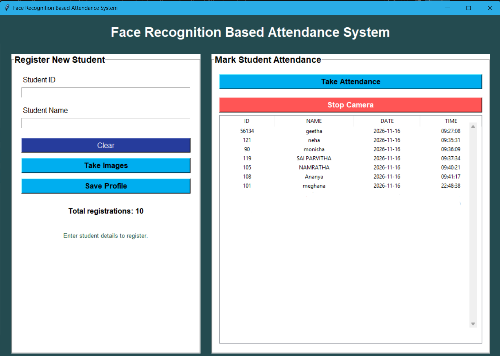

# Face Recognition Attendance System
### A Python Tkinter GUI Project

## Project Overview

The **Face Recognition Attendance System** is a desktop application developed using **Python and Tkinter**. It provides a graphical user interface (GUI) that allows users to register students, capture their facial images, train a face recognition model, and automatically record attendance.

The application's main interface is designed using **Tkinter**, while **OpenCV** is used for webcam access, face detection, and face recognition.
## GUI Screenshots

### Main Tkinter Interface


## Technologies Used

- **Python** – Main programming language.
- **Tkinter** – Used to develop the desktop graphical user interface (GUI).
- **OpenCV** – Used for webcam access, face detection, and face recognition.
- **NumPy** – Used for handling image data during model training.
- **CSV** – Used to store student details and attendance records.

## Key Features

- **Tkinter GUI:** User-friendly desktop interface with buttons, input fields, and an attendance table.
- **Student Registration:** Register students using their ID and name.
- **Face Image Capture:** Capture facial images through a webcam.
- **Face Recognition:** Recognize registered students using a trained model.
- **Automatic Attendance:** Record student attendance with date and time.
- **CSV Storage:** Store student information and attendance records locally.

## Project Files

- `attendance_system_fixed.py` – Main Python application containing the Tkinter GUI and application functionality.
- `haarcascade_frontalface_default.xml` – Haar Cascade classifier used for face detection.

## Installation and Execution

### 1. Install the required libraries

```bash
pip install opencv-contrib-python numpy
```

### 2. Keep the project files together

Make sure the Python file and XML classifier are in the same project folder.

### 3. Run the application

```bash
python attendance_system_fixed.py
```

## How to Use

1. Enter the student's ID and name.
2. Click **Take Images** to capture facial images.
3. Click **Save Profile** to train the face recognition model.
4. Click **Take Attendance** to recognize registered students.
5. Attendance details are recorded automatically with the date and time.

## Data Storage

The application creates an `AttendanceData` folder to store student details, captured training images, the trained recognition model, and attendance records.


## Privacy Note

The system should only be used with the knowledge and permission of individuals whose facial images are registered. Student information and facial images should be stored securely.
